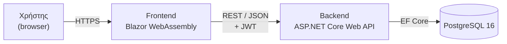
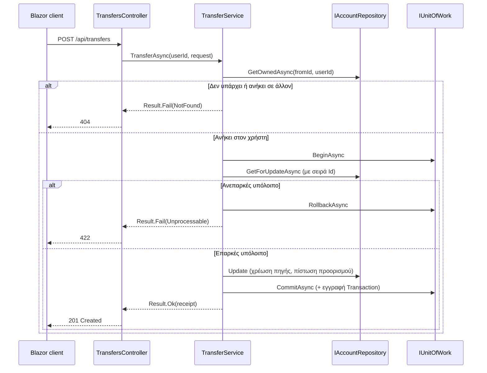
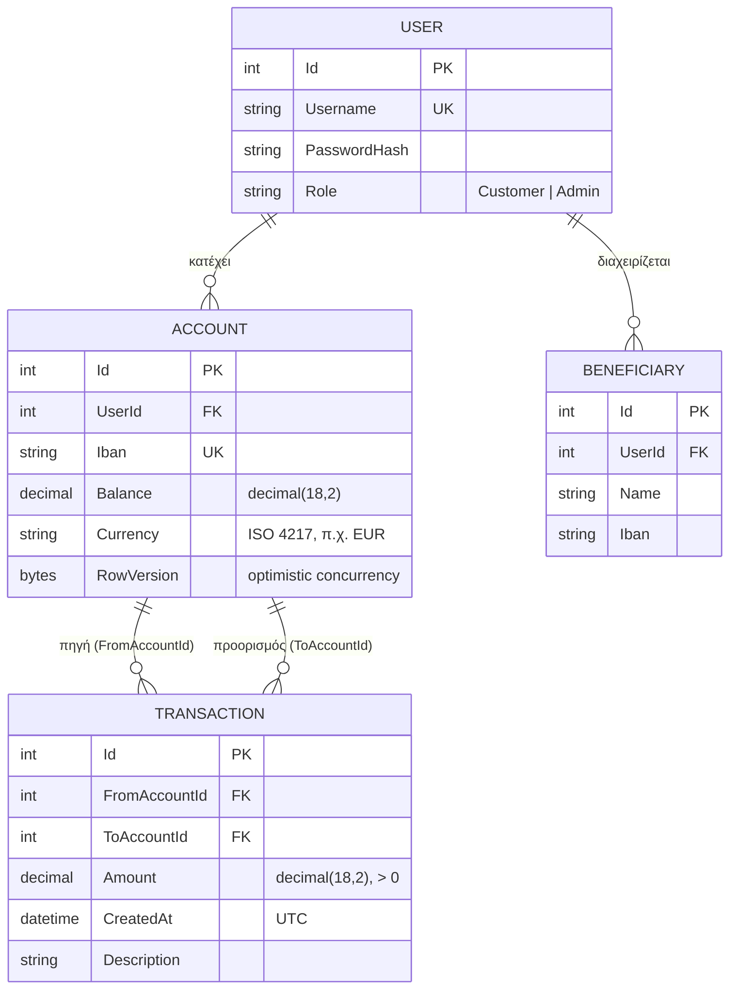

# WebBankingApp

Web εφαρμογή internet banking. Οι πελάτες βλέπουν τους λογαριασμούς τους, μεταφέρουν χρήματα, διαχειρίζονται δικαιούχους και βλέπουν το ιστορικό συναλλαγών. Οι διαχειριστές διαχειρίζονται χρήστες και λογαριασμούς.

Αυτό το αρχείο είναι η μοναδική τεκμηρίωση του έργου: απαιτήσεις, αρχιτεκτονική, API, οδηγίες εκτέλεσης και κανόνες συνεργασίας.

---

## 1. Τεχνολογίες

| Επίπεδο | Τεχνολογία | Ρόλος |
|---|---|---|
| Frontend | **Blazor WebAssembly** (C#) | SPA που τρέχει στον browser |
| Backend | **ASP.NET Core Web API** (C#) | REST API, επιχειρησιακή λογική, έλεγχος ταυτότητας |
| Πρόσβαση στα δεδομένα | **EF Core** (ORM) + **Repository pattern** | Η μόνη πρόσβαση στη βάση |
| Βάση δεδομένων | **PostgreSQL 16** | Σχεσιακή αποθήκευση |
| Εκτέλεση τοπικά | Docker Compose | Εκκίνηση της βάσης |
| Tests | xUnit + `WebApplicationFactory`, Playwright | Integration και end-to-end tests |

Κανόνες που ισχύουν σε όλη την εφαρμογή:

- **Dependency Injection** παντού. Τα services και τα repositories εγγράφονται στο `Program.cs`. Ποτέ `new` για service μέσα σε controller.
- **Result pattern**: οι επιχειρησιακές αποτυχίες επιστρέφονται ως `Result<T>`, δεν πετάγονται ως exceptions.
- **Repository pattern**: τα services εξαρτώνται από interfaces repository, όχι από το `DbContext`.
- **ORM μόνο**: καμία χειροκίνητη SQL. Το schema αλλάζει μόνο με EF Core migrations.
- Το frontend μιλά με το backend **μόνο** μέσω RESTful web services με JSON.

---

## 2. Απαιτήσεις (User Stories)

Μορφή: _Ως [ρόλος] θέλω [λειτουργία] ώστε [όφελος]._ Κάθε story χωράει σε ένα sprint.

| ID | Ως | Θέλω | Κριτήρια αποδοχής | Προτ. | Sprint | Story points |
|---|---|---|---|---|---|---|
| US-01 | Επισκέπτης | να δημιουργώ λογαριασμό | Μοναδικό username, κωδικός μόνο ως hash | Υψηλή | 1 | 3 |
| US-02 | Χρήστης | να συνδέομαι με username και password | Επιστρέφεται JWT, λάθος στοιχεία → μήνυμα σφάλματος | Υψηλή | 1 | 3 |
| US-03 | Πελάτης | να βλέπω τους λογαριασμούς και τα υπόλοιπά μου | Μόνο δικοί μου λογαριασμοί | Υψηλή | 2 | 3 |
| US-04 | Πελάτης | να μεταφέρω χρήματα σε άλλο λογαριασμό | Έλεγχος επαρκούς υπολοίπου, ατομική ενημέρωση | Υψηλή | 2 | 5 |
| US-05 | Πελάτης | να βλέπω το ιστορικό συναλλαγών | Ημερομηνία, ποσό, αντισυμβαλλόμενος, σελιδοποίηση | Μεσαία | 3 | 3 |
| US-06 | Πελάτης | να διαχειρίζομαι δικαιούχους (CRUD) | Προσθήκη, επεξεργασία, διαγραφή μόνο των δικών μου | Μεσαία | 3 | 3 |
| US-07 | Διαχειριστής | να βλέπω και να διαχειρίζομαι χρήστες και λογαριασμούς | Πρόσβαση μόνο με ρόλο `Admin` (RBAC) | Μεσαία | 4 | 5 |
| US-08 | Πελάτης | να αποσυνδέομαι | Το token διαγράφεται από τον client | Χαμηλή | 1 | 1 |

Κατάσταση κάθε story στο board: `Backlog` → `Sprint` → `Σε εξέλιξη` → `Έλεγχος` → `Ολοκληρώθηκε`.

- **Product backlog:** ο πίνακας παραπάνω.
- **Board (εργαλείο παρακολούθησης sprints):** [σύνδεσμος board](ΣΥΝΔΕΣΜΟΣ_BOARD) (Trello, Jira ή Azure DevOps). Ένα sprint = μία ομάδα stories στο board.

---

## 3. Αρχιτεκτονική

### 3.1 Γράφημα συστήματος



Το backend έχει 3 layers: **Controllers → Services → Repositories**. Τα services εξαρτώνται από τα interfaces των repositories, και η υλοποίηση με EF Core εγχέεται μέσω DI.

### 3.2 Στρώματα του backend

| Στρώμα | Φάκελος | Επιτρέπεται | Δεν επιτρέπεται |
|---|---|---|---|
| Controllers | `Controllers/` | Λήψη request, κλήση service, μετατροπή `Result` σε HTTP status | Επιχειρησιακοί κανόνες, πρόσβαση στο `DbContext` |
| Services | `Services/` | Κανόνες (υπόλοιπο, ownership), συντονισμός transactions, επιστροφή `Result<T>` | Γνώση HTTP, `IActionResult`, EF Core |
| Repository interfaces | `Services/Abstractions/` | Ορισμός συμβολαίου πρόσβασης σε δεδομένα | Υλοποιήσεις |
| Data | `Data/` | `AppDbContext`, entities, υλοποιήσεις repositories, migrations | Κανόνες εφαρμογής |

### 3.3 Result pattern

Τα services δεν πετούν exceptions για αναμενόμενες αποτυχίες (λάθος κωδικός, ανεπαρκές υπόλοιπο, μη υπαρκτός λογαριασμός). Επιστρέφουν `Result<T>`. Τα exceptions κρατιούνται για σφάλματα προγραμματισμού.

```csharp
public sealed record Error(ErrorType Type, string Message);

public enum ErrorType { Validation, Unauthorized, NotFound, Conflict, Unprocessable }

public readonly record struct Result<T>(T? Value, Error? Error)
{
    public bool IsSuccess => Error is null;
    public static Result<T> Ok(T value) => new(value, null);
    public static Result<T> Fail(Error error) => new(default, error);
}
```

Ο παρακάτω πίνακας αντιστοιχίζει κάθε `ErrorType` (από το `WebBanking.Contracts.Common`) στον αντίστοιχο κωδικό HTTP status που επιστρέφει ο controller:

| `ErrorType` | HTTP status |
|---|---|
| (επιτυχία) | `200 OK` ή `201 Created` |
| `Validation` | `400 Bad Request` |
| `Unauthorized` | `401 Unauthorized` |
| `NotFound` | `404 Not Found` |
| `Conflict` | `409 Conflict` |
| `Unprocessable` (π.χ. ανεπαρκές υπόλοιπο) | `422 Unprocessable Entity` |

Ο ίδιος τύπος `Result<T>` χρησιμοποιείται και στο frontend. Το `ApiClient` επιστρέφει `Result<T>`, οπότε η UI χειρίζεται τα σφάλματα με τον ίδιο τρόπο.

### 3.4 Repository pattern

```csharp
// Services/Abstractions/IAccountRepository.cs
public interface IAccountRepository
{
    Task<Account?> GetOwnedAsync(int accountId, int userId, CancellationToken ct);
    Task<Account?> GetForUpdateAsync(int accountId, CancellationToken ct); // SELECT ... FOR UPDATE
    void Update(Account account);
}

// Services/Abstractions/IUnitOfWork.cs
public interface IUnitOfWork
{
    Task BeginAsync(CancellationToken ct);
    Task CommitAsync(CancellationToken ct);
    Task RollbackAsync(CancellationToken ct);
}
```

- Οι repositories επιστρέφουν entities. Δεν επιστρέφουν `IQueryable`, ώστε η λογική να μην διαρρέει στο query.
- Τα repositories δεν έχουν επιχειρησιακούς κανόνες. Ο έλεγχος υπολοίπου είναι στο service.
- Τα repositories δεν κάνουν `SaveChanges` μόνα τους. Η αποθήκευση γίνεται μέσω του `IUnitOfWork`, ώστε πολλαπλές αλλαγές να μπαίνουν στο ίδιο transaction.

### 3.5 Ροή μεταφοράς χρημάτων (US-04)

Η μεταφορά είναι **ατομική**: χρεώνεται η πηγή και πιστώνεται ο προορισμός, ή δεν αλλάζει τίποτα. Δύο ταυτόχρονες μεταφορές από τον ίδιο λογαριασμό δεν περνούν και τις δύο χωρίς έλεγχο υπολοίπου.



- Τα δύο κλειδώματα γίνονται πάντα με αύξουσα σειρά `Id`. Έτσι αποφεύγονται τα deadlocks.
- Ο λογαριασμός που δεν ανήκει στον χρήστη επιστρέφει `404`, όχι `403`. Δεν αποκαλύπτουμε ότι υπάρχει.
- Το ποσό είναι `decimal(18,2)` στη βάση και `decimal` στον κώδικα. Ποτέ `float` ή `double` για χρήματα.
- Το ποσό πρέπει να είναι θετικό και ο προορισμός διαφορετικός από την πηγή. Ο έλεγχος γίνεται στο service.

### 3.6 Έλεγχος ταυτότητας και δικαιωμάτων

- **Login:** username και password. Ο κωδικός ελέγχεται με `PasswordHasher` (ASP.NET Core Identity). Αποθηκεύεται μόνο το hash.
- **JWT:** εκδίδεται με `Issuer` και `Expires` από το `.env` (`JWT_ISSUER`, `JWT_EXPIRES_MINUTES`). Το `JWT_SECRET` δεν μπαίνει ποτέ στο repo.
- **RBAC:** ρόλοι `Customer` και `Admin`. Τα endpoints `/api/admin/*` έχουν `[Authorize(Roles = "Admin")]`.
- **Ownership:** το `userId` παίρνεται από τα claims του JWT, όχι από το body του request.
- **Frontend:** το `AuthenticationStateProvider` και η απόκρυψη μενού ανά ρόλο είναι μόνο για την εμφάνιση. Η προστασία είναι στο backend.
- **Logout (US-08):** το token διαγράφεται από τον client.

---

## 4. Μοντέλο δεδομένων



- Το `Balance` ενημερώνεται στο ίδιο transaction με την εγγραφή της `TRANSACTION`. Οι `TRANSACTION` είναι το ιστορικό (ledger) και δεν τροποποιούνται ούτε διαγράφονται.
- Το `RowVersion` είναι ο έλεγχος ταυτόχρονων ενημερώσεων, μαζί με το κλείδωμα της ενότητας 3.5.
- Η λίστα ιστορικού (US-05) είναι σελιδοποιημένη (`?page=&pageSize=`), ταξινομημένη ανά `CreatedAt` φθίνουσα.

---

## 5. API

Βάση διαδρομής: `/api`. JSON. `Authorization: Bearer <JWT>` σε όλα εκτός από τα `/api/auth/*`.

| Μέθοδος | Διαδρομή | Ρόλος | Περιγραφή | Story |
|---|---|---|---|---|
| POST | `/api/auth/register` | Ανώνυμος | Εγγραφή (`Customer`) | US-01 |
| POST | `/api/auth/login` | Ανώνυμος | Σύνδεση, επιστρέφει JWT | US-02 |
| GET | `/api/accounts` | Customer | Λογαριασμοί και υπόλοιπα | US-03 |
| POST | `/api/transfers` | Customer | Μεταφορά χρημάτων | US-04 |
| GET | `/api/transactions?page=&pageSize=` | Customer | Ιστορικό, σελιδοποιημένο | US-05 |
| GET | `/api/beneficiaries` | Customer | Λίστα δικαιούχων | US-06 |
| POST | `/api/beneficiaries` | Customer | Προσθήκη δικαιούχου | US-06 |
| PUT | `/api/beneficiaries/{id}` | Customer | Επεξεργασία (μόνο δικού του) | US-06 |
| DELETE | `/api/beneficiaries/{id}` | Customer | Διαγραφή (μόνο δικού του) | US-06 |
| GET | `/api/admin/users` | Admin | Λίστα χρηστών | US-07 |

Οι κωδικοί απόκρισης ακολουθούν τον πίνακα του `Result` στην ενότητα 3.3.

---

## 6. Frontend (Blazor WebAssembly)

- Σελίδες: Σύνδεση / Εγγραφή, Λογαριασμοί, Μεταφορά, Ιστορικό, Δικαιούχοι, Διαχείριση (μόνο `Admin`).
- `ApiClient`: ένα typed `HttpClient` που προσθέτει το JWT, επιστρέφει `Result<T>` και στέλνει τον χρήστη στη σύνδεση σε `401`.
- DTOs (requests και responses) σε κοινό class library `WebBanking.Contracts/`, που αναφέρεται από το frontend και το backend. Έτσι τα συμβόλαια API δεν αποκλίνουν.
- Το JWT αποθηκεύεται σε `localStorage` μέσω JS interop. Βλ. ανοιχτά θέματα.

---

## 7. Δομή του repository

```text
WebBankingApp/
├── WebBanking.slnx               # Λύση με τα 4 projects
├── README.md                     # Η μοναδική τεκμηρίωση
├── docker-compose.yml            # PostgreSQL 16 για τοπική ανάπτυξη
├── .env.example                  # Πρότυπο ρυθμίσεων (το .env δεν ανεβαίνει)
├── .editorconfig
├── .gitignore
├── .github/                      # Templates για PR και issues
├── database/                     # Seed data και βοηθητικά scripts
├── WebBanking.Api/               # ASP.NET Core Web API
│   ├── Controllers/              # HTTP endpoints, μετατροπή Result → HTTP
│   ├── Services/                 # Κανόνες εφαρμογής
│   │   └── Abstractions/         # Interfaces repositories και UnitOfWork
│   ├── Data/                     # AppDbContext, entities, repositories, migrations
│   └── Common/                   # Result<T>, Error
├── WebBanking.Client/            # Blazor WebAssembly
├── WebBanking.Contracts/         # DTOs κοινά για client και API
├── WebBanking.Tests/             # xUnit + WebApplicationFactory (integration)
└── tests/
    └── e2e/                      # Playwright
```

---

## 8. Εκτέλεση τοπικά

Build της λύσης:

```bash
dotnet build WebBanking.slnx
```

Ρυθμίσεις:

```bash
cp .env.example .env
```

### Φόρτωση μεταβλητών περιβάλλοντος

Πριν από την εκκίνηση του API, αντικαταστήστε
τις ενδεικτικές τιμές στο `.env` με τοπικές
ρυθμίσεις και ένα ισχυρό JWT_SECRET.

Για το JWT_SECRET προτιμήστε ένα τυχαίο κλειδί με
χαρακτήρες ασφαλείς για το shell, π.χ. από την εντολή
`openssl rand -hex 32`, ώστε το `source .env` να μην
αλλοιώνει την τιμή του.

Σε macOS/Linux (bash ή zsh), από τον κεντρικό
φάκελο του repository εκτελέστε:

```bash
set -a
source .env
set +a
```

Το ASP.NET Core δεν φορτώνει αυτόματα το `.env`.
Το αρχείο πρέπει να προέρχεται από αξιόπιστη
πηγή και δεν πρέπει να ανεβαίνει στο GitHub.

Εκκίνηση της βάσης (απαιτείται Docker σε λειτουργία) και έλεγχος υγείας:

```bash
docker compose up -d --wait db
docker compose ps
docker compose exec db sh -c 'psql -U "$POSTGRES_USER" -d "$POSTGRES_DB" -c "select 1"'
```

Τερματισμός της βάσης (τα δεδομένα διατηρούνται) ή πλήρης επαναφορά (σβήνει τα δεδομένα):

```bash
docker compose down
docker compose down -v
```

Εφαρμογή migrations και εκτέλεση του API (το `dotnet ef` προστίθεται με το KAN-25):

```bash
dotnet ef database update --project WebBanking.Api
dotnet run --project WebBanking.Api
```

Εκκίνηση του frontend σε άλλο terminal:

```bash
dotnet run --project WebBanking.Client
```

Tests:

```bash
dotnet test WebBanking.Tests
npx playwright test
```

---

## 9. Ποιότητα και ασφάλεια

- Κανένα μυστικό (κωδικοί, `JWT_SECRET`) στο repo. Ρυθμίσεις μόνο μέσω `.env`.
- Κωδικοί μόνο ως hash.
- Όλα τα inputs επικυρώνονται στο backend (μήκη, μορφή IBAN, θετικό ποσό).
- Το EF Core παραμετροποιεί τα queries. Δεν γίνεται σύνθεση SQL από strings.
- Το CORS επιτρέπει μόνο την origin του frontend.
- Σε παραγωγή: HTTPS για όλη την επικοινωνία.

### Μορφή κώδικα και UI

- **Μορφή κώδικα:** ισχύει το `.editorconfig` (εσοχές, κωδικοποίηση, τέλη γραμμών). Πριν από κάθε PR ο κώδικας πρέπει να είναι σε αυτή τη μορφή.
- **UI:** ενιαία εμφάνιση σε όλες τις σελίδες (ίδια χρώματα, ίδια θέση μενού και κουμπιών). Η εφαρμογή λειτουργεί σε desktop και κινητό χωρίς οριζόντια κύλιση.
- **Μηνύματα:** τα σφάλματα του backend εμφανίζονται στη UI ως φιλικά μηνύματα, από το `Result<T>`.

### Tests

Δεν απαιτούνται unit tests. Απαιτούνται **αυτοματοποιημένα integration tests** μέχρι το τέλος του εξαμήνου. Τα tests τρέχουν πριν ολοκληρωθεί κάθε sprint· ένα story δεν θεωρείται ολοκληρωμένο αν δεν περνούν.

- **Integration (`WebBanking.Tests/`):** xUnit με `WebApplicationFactory` σε δοκιμαστική βάση PostgreSQL. Καλύπτουν: εγγραφή και σύνδεση, μεταφορά με επαρκές και ανεπαρκές υπόλοιπο, `401` / `403` / `404`, CRUD δικαιούχων.
- **End-to-end (`tests/e2e/`):** Playwright για τις βασικές ροές από το UI.

---

## 10. Συνεργασία

### Ομάδα

Κάθε ομάδα έχει 4 μέλη. Η δήλωση γίνεται στο [αρχείο συμμετοχών 2025-26](ΣΥΝΔΕΣΜΟΣ_ΑΡΧΕΙΟΥ_ΣΥΜΜΕΤΟΧΩΝ).

| Μέλος | GitHub |
|---|---|
| ΟΝΟΜΑ ΕΠΩΝΥΜΟ | @username |
| ΟΝΟΜΑ ΕΠΩΝΥΜΟ | @username |
| ΟΝΟΜΑ ΕΠΩΝΥΜΟ | @username |
| ΟΝΟΜΑ ΕΠΩΝΥΜΟ | @username |

### Branches

- `main`: σταθερός και παραδοτέος κώδικας. Χωρίς άμεσα commits.
- `feature/<περιγραφή>`: νέα λειτουργία (π.χ. `feature/money-transfer`).
- `fix/<περιγραφή>`: διόρθωση σφάλματος.
- `docs/<περιγραφή>`: αλλαγές τεκμηρίωσης.

Κάθε branch αντιστοιχεί σε μία user story.

### Commits

Μικρά, συχνά commits με περιγραφικό μήνυμα στα ελληνικά, σε προστακτική ή παρελθοντικό χρόνο. Π.χ.: `Προσθήκη endpoint μεταφοράς χρημάτων`, `Διόρθωση υπολογισμού υπολοίπου μετά από ανάληψη`.

### Pull requests

1. Branch από το `main`.
2. Push και PR (το template συμπληρώνεται αυτόματα).
3. Σύνδεση με τη story: `Closes #αριθμός`.
4. Τουλάχιστον ένα μέλος κάνει review πριν το merge.
5. Μετά το merge, διαγραφή του branch.

### Κανόνες κώδικα

- Αρχιτεκτονική 3 επιπέδων: Controllers → Services → Repositories.
- DI παντού. Χωρίς `new` για services μέσα σε controllers.
- Πρόσβαση στη βάση μόνο μέσω EF Core και repositories.
- Κανένα μυστικό στο repo.

### Ροή sprint

- Διάρκεια 15 ημέρες. Κάθε sprint έχει στήλη ή ετικέτα στο board με τα stories του.
- Sprint planning: επιλογή stories από το backlog της ενότητας 2.
- Review και retrospective στο τέλος κάθε sprint.

---

## 11. Παραδοτέο (checklist βαθμολογίας)

| Πεδίο | Μονάδες | Έτοιμο |
|---|---|---|
| Αποθετήριο κώδικα στο GitHub | 2 | ☐ |
| Εργαλείο παρακολούθησης sprints και χρήση του | 2 | ☐ |
| Dependency Injection | 1 | ☐ |
| ORM (EF Core) | 1 | ☐ |
| Integration tests | 2 | ☐ |
| Μορφή κώδικα και UI | 2 | ☐ |

Υπενθυμίσεις:

- ☐ Δήλωση ομάδας στο αρχείο συμμετοχών
- ☐ Πρόσβαση στον διδάσκοντα αν το repo είναι ιδιωτικό
- ☐ Η εφαρμογή τρέχει στον browser
- ☐ User stories, backlog και board ενημερωμένα ανά sprint
- ☐ Integration tests πριν το τέλος του εξαμήνου

---

## 12. Ανοιχτά θέματα

| Θέμα | Τρέχουσα πρόταση | Σχόλιο |
|---|---|---|
| Ρόλοι | `Role` ως enum στο `User` | Με δύο ρόλους, το enum αρκεί. |
| Αποθήκευση JWT στον browser | `localStorage` μέσω JS interop | Ευάλωτο σε XSS. Να αποφασιστεί από την ομάδα. |
| Refresh tokens | Όχι στη φάση 1 | Το JWT λήγει μετά `JWT_EXPIRES_MINUTES`. |
| Νόμισμα | Ένα νόμισμα ανά λογαριασμό, μεταφορά μόνο στο ίδιο νόμισμα | Η μετατροπή νομισμάτων είναι εκτός πεδίου. |
| Μεταφορές εκτός συστήματος | Εκτός πεδίου | Το `ToAccountId` είναι ξένο κλειδί. |
